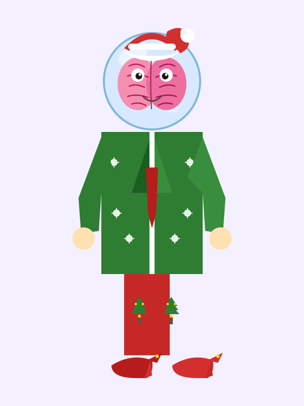

# Brainy Elf Holiday

Brainy Elf Holiday is an open source holiday-themed vector illustration project featuring a whimsical character with a green suit jacket, red sweatpants, and a glass ball head containing a realistic pink brain. The project provides a complete scalable SVG file designed for festive decorations, greeting cards, digital art projects, and holiday-themed merchandise. Perfect for designers, developers, and crafters looking to incorporate a unique Christmas character into their creative work.

## Install

To get started with Brainy Elf Holiday, simply download the `character.svg` file from the repository. No additional installation steps or dependencies are required. The file works with any modern web browser, vector graphics editor, or design tool.

### Option 1: Direct Download
1. Navigate to the GitHub repository
2. Locate the `character.svg` file
3. Click the download button or clone the entire repository to your local machine

### Option 2: Clone Repository
```bash
git clone https://github.com/yourusername/brainy-elf-holiday.git
cd brainy-elf-holiday
```

## Use

The SVG file can be used in multiple ways depending on your project needs.

### Viewing the Character
Open the SVG file directly in any web browser to view the character:
- Double-click the `character.svg` file
- It will display in your default browser
- The vector graphics scale perfectly at any zoom level

### Integrating into HTML
Add the character to any webpage using standard HTML embed methods:
```html

```

### Editing in Design Software
Import the SVG file into popular design tools:
- Adobe Illustrator
- Inkscape (free)
- Figma
- Canva
- Sketch

### Customization and Printing
- Scale the character to any size without quality loss
- Change colors using any SVG editor
- Export to PNG or PDF for digital or physical use
- Create greeting cards, posters, stickers, or web decorations

---

More open source project projects by EnderDevelopment: https://github.com/EnderDevelopment

Project page: https://dash.enderdevelopment.com/community/544a8b9d-d6be-4eff-ac59-e4591ce233b9?utm_source=github&utm_medium=readme&utm_campaign=auto_publish&utm_content=544a8b9d-d6be-4eff-ac59-e4591ce233b9
